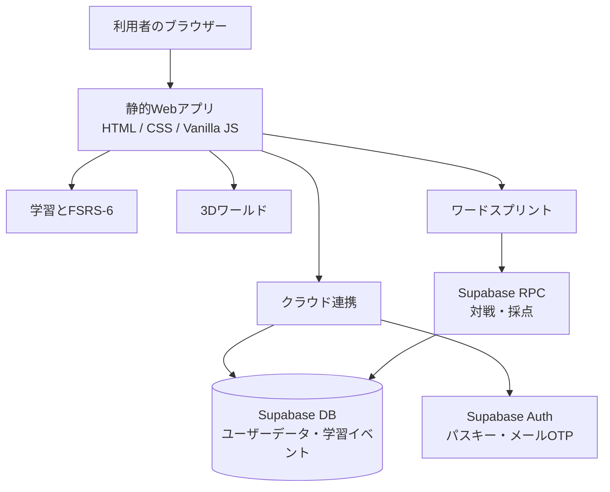

<div align="center">

# コトミア · Kotomia

### 英単語の学びを、毎日の小さな冒険に。

**学習・旅・対戦をひとつにまとめた、英単語学習Webアプリ。**  
自分のペースで復習し、3Dワールドを探索し、60秒のワードスプリントに挑戦できます。

[](https://github.com/rattokun-1/lexora/releases/tag/v1.4.3)
[](https://github.com/rattokun-1/lexora/releases/tag/v1.4.3-pre)


**[アプリを開く](https://tanq.dashcloudly.com/)** · **[はじめる](#quick-start)** · **[機能](#features)** · **[技術構成](#architecture)** · **[リリース](https://github.com/rattokun-1/lexora/releases)**

</div>

---

<a id="features"></a>
## Features

> 短い操作で、学ぶ・探索する・挑戦する。日々の英単語学習を続けやすくする4つの柱。

<table>
<tr>
<td width="50%" valign="top">

### 📚 Learn · 学習

初回のレベル診断から、習得度に合わせた復習まで。

- `new-word-data.js` に基づく英単語学習
- 回答に応じた動的な初回診断
- **FSRS-6** による復習スケジューリング
- 1回に導入する新出単語は最大5語
- 意味選択・認識・スペルの段階的な復習
- 進行状況・連続学習・習得状態を端末に保存

</td>
<td width="50%" valign="top">

### 🗺️ Explore · 旅

学習とともに広がる、見下ろし型の3Dワールド。

- 道の外も歩ける地形探索
- 学習進行に応じた地域・ゲートの解放
- 会話・依頼・宝箱・季節イベント
- 任意で楽しめるガチャ要素
- 戦闘・ランキング・フレンド機能なし

</td>
</tr>
<tr>
<td width="50%" valign="top">

### ⚡ Word Sprint · 対戦

**60秒**のランダムマッチで、単語の正解数を競う。

- 正解数で勝敗を決定
- 開始・終了時刻と採点はサーバーで判定
- ポーリング中も選択肢のフォーカスを維持
- 待機キャンセル・時間切れ・通信エラーに対応
- 設定済みプロフィール画像を自分側に表示
- 対戦回答は通常の習得判定には反映しない

</td>
<td width="50%" valign="top">

### 🔐 Account · アカウント

パスキーで認証し、学習状態をクラウドに同期。

- **Supabase Auth** のパスキー認証
- 登録・復旧時はメールOTP確認後にパスキー登録
- パスワード認証は不使用
- プロフィール画像・ニックネーム・設定
- ローカル学習データのクラウド同期
- RLSによるユーザー単位のデータ分離

</td>
</tr>
</table>

<a id="quick-start"></a>
## Quick Start

**必要環境:** Node.js 22以上 / npm。クラウド機能を使う場合はSupabaseプロジェクトも必要です。

```powershell
npm install
npm run check
npm test
npm run build
```

`npm run build` は公開用の静的ファイルを `dist/` にコピーします。

ローカルで表示する場合は、プロジェクトのルートで静的HTTPサーバーを起動します。

```powershell
npx --yes serve .
```

> [!IMPORTANT]
> `file://` から直接開くと、ES Module・認証・Service Workerが正常に動作しない場合があります。

<a id="architecture"></a>
## Architecture

<div align="center">

**Static frontend × Supabase backend**

</div>



**Technology**

| レイヤー | 技術・役割 |
| :-- | :-- |
| Frontend | HTML / CSS / Vanilla JavaScript |
| Learning | FSRS-6、ローカル進行管理 |
| World | 3Dマップの読み込み・探索 |
| Backend | Supabase Auth、Database、RPC、RLS |
| Delivery | 静的ファイル、GitHub Actions、Release ZIP |

---

## 学習データの収集とモデル

復習の改善に使用するため、認証済みユーザーの回答から次のイベントを収集します。

- 単語ID、出題形式、正誤
- 前回学習からの経過日数
- FSRSの予測値
- 回答時間
- モデルバージョン、発生日時

氏名、メールアドレス、プロフィール画像はモデル用イベントに含めません。ただし、仮名化データは完全匿名ではありません。

収集経路は次のとおりです。

1. 回答を端末キューへ保存（最大500件）
2. ログイン中に認証済みRPCへ最大100件ずつ送信
3. 非公開スキーマに仮名化して保存
4. 運用者が評価用データをエクスポート
5. 条件を満たしたモデルだけ評価・承認して適用

現時点の標準スケジューラーはFSRS-6です。独自モデルは、学習500件以上、検証100件以上、FSRSに対する評価改善などの条件を満たすまで適用されません。詳細は[`docs/v1.4.0.md`](docs/v1.4.0.md)を参照してください。

## 技術構成

### ブラウザー側

- HTML / CSS / Vanilla JavaScript
- `src/app.js`: 画面遷移、状態、学習UI、プロフィール、モーダル
- `src/scheduler.js`: FSRS、復習計画、回答後の更新
- `src/learning-events.js`: モデル用イベントの作成
- `src/duel.js`: ワードスプリントの状態取得、回答、タイマー
- `src/adventure-data.js` / `src/world-data.js`: 旅のデータと進行
- `src/world-loader.js` / `src/world-map.js`: 3Dマップの読み込みとライフサイクル
- `src/cloud.js`: Supabase接続、認証、同期、レビュー送信

### Supabase

- Auth: パスキー、メールOTP
- `user_data`: ユーザーごとの保存データ
- `private.learning_events`: 仮名化した学習イベント
- `public.learning_models`: 適用済みモデルの公開読み取り
- RPC: レビュー記録、対戦、モデル運用、古いデータの削除

SQLは[`supabase/migrations/`](supabase/migrations/)を日付順に適用します。静的配布ZIPにはSQLやテストを含めません。

## 開発環境・検証手順

### 必要環境

- Node.js 22以上
- npm
- Supabaseプロジェクト（クラウド機能を使う場合）

### 検証

```powershell
npm install
npm run check
npm test
npm run build
```

`npm run build`は、公開に必要なファイルを`dist/`へコピーします。

### ローカル表示

ルートディレクトリを静的HTTPサーバーで配信してください。`file://`ではES Module、認証、Service Workerが正しく動作しない場合があります。

```powershell
npx --yes serve .
```

## Supabaseの初期設定

1. Supabaseプロジェクトを作成します。
2. `src/cloud-config.js`にProject URLとpublishable keyだけを設定します。
3. `supabase/migrations/`のSQLをファイル名の日時順に適用します。
4. AuthenticationでPasskeysを有効にします。
5. 本番のRP IDとOriginを設定します。
   - RP ID: `tanq.dashcloudly.com`
   - Origin: `https://tanq.dashcloudly.com`
6. メールOTPテンプレートとResend SMTPを設定します。
7. 認証済みのテストユーザーでログイン、同期、復旧を確認します。

詳細は[`docs/supabase-setup.md`](docs/supabase-setup.md)と[`docs/account-onboarding.md`](docs/account-onboarding.md)を参照してください。

### 秘密情報の扱い

- リポジトリにservice_roleキー、SMTPパスワード、秘密鍵を保存しない
- `src/cloud-config.js`にはブラウザー公開用のキーだけを置く
- service_roleキーはモデル運用などの管理端末の環境変数だけで使用する
- 実ユーザーの学習履歴をログ、Issue、PR、テストデータへ出さない

## 本番サーバーへの実装方法

コトミアのWeb部分は静的ファイルです。Node.jsを本番サーバーで常駐させる必要はありません。

### ZIPを使う方法

1. GitHub Releasesから対象バージョンのZIPを取得します。
   - [v1.4.3](https://github.com/rattokun-1/lexora/releases/tag/v1.4.3)
   - [v1.4.3-pre](https://github.com/rattokun-1/lexora/releases/tag/v1.4.3-pre)
2. 現在の公開フォルダーをバックアップします。
3. ZIPを公開ルートへ展開します。
4. `index.html`、`src/`、`new-word-data.js`、`.htaccess`が同じ公開ルートにあることを確認します。
5. HTTPSで配信します。
6. SupabaseのPasskeys設定で本番Originを確認します。
7. ブラウザーでホーム、学習、旅、プロフィール、ワードスプリントを確認します。

ZIPには公開用静的ファイルだけが含まれます。SQL、テスト、開発資料、service_roleキーは含まれません。

### Apacheの注意

`.htaccess`を使用する場合は、ApacheでAllowOverrideが有効になっていることを確認してください。別サーバーを使う場合は、SPAのフォールバック、HTTPS、静的ファイルのMIME type、圧縮、キャッシュ設定をサーバー側で設定します。

### DBとWebの適用順

1. バックアップを取得
2. Supabaseのmigrationを適用
3. CIを通過したZIPを展開
4. 認証とデータ同期を確認
5. 問題があれば静的ファイルを前バージョンへ戻し、DB変更はmigrationのロールバック方針に従う

本番DBの直接変更、タグの上書き、サーバーへの自動ログインはこのリポジトリでは行いません。

## CI/CD

### CI

GitHub Actionsの[`ci.yml`](.github/workflows/ci.yml)は、pushとPull Requestで次を実行します。

- JavaScript構文と秘密情報パターンの確認
- `npm test`
- 静的ビルド
- PostgreSQLを使ったmigration・権限テスト
- ビルド成果物のArtifact保存

### CD

[`release.yml`](.github/workflows/release.yml)は`v*`タグのpushで起動します。

1. check、test、buildを実行
2. `dist/`をZIP化
3. GitHub Releaseを作成
4. ZIPをRelease Artifactとして添付

例:

```powershell
git tag -a v1.4.4 -m "Kotomia v1.4.4"
git push origin v1.4.4
```

既存タグの上書きは行わないでください。先行版は`v1.4.4-pre`のように別タグを使用します。

## 整形とコード構成

Prettierの設定は[`.prettierrc.json`](.prettierrc.json)、対象外は[`.prettierignore`](.prettierignore)で管理しています。

```powershell
npx --yes prettier@3.6.2 --write .
```

vendor、生成物、巨大データは整形対象外です。詳しい責務分担は[`docs/code-organization.md`](docs/code-organization.md)を参照してください。

## 運用上の制限

- 実ユーザー2人による同時対戦は別途安全なテスト環境で確認する
- 本番のパスキー、メール送信、DB保存はリリース前に実アカウントで確認する
- 未学習の独自モデルを「学習済み」と説明しない
- 学習データを完全匿名と表現しない
- ランキング、フレンド、パスワード認証を復活させない
- ローカル保存データと既存パスキーの互換性を壊さない

## ライセンス

第三者ライブラリのライセンスは[`src/vendor/`](src/vendor/)内に保存しています。
